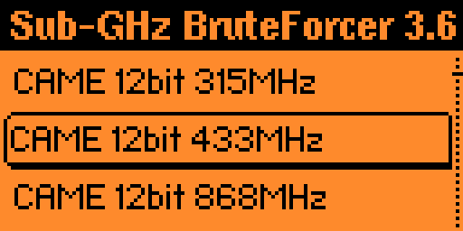

# Sub-GHz Continuous BruteForcer for Flipper Zero

Hold-to-attack Sub-GHz bruteforcer for Flipper Zero — just **hold the OK button for a few seconds** and the app continuously spams codes across the selected protocol/frequency family, with no manual step-by-step interaction.

Based on [flipperzero-subbrute](https://github.com/DarkFlippers/flipperzero-subbrute) (SubGhz BruteForcer from [Unleashed Firmware](https://github.com/DarkFlippers/unleashed-firmware).

## What makes it different

- **Continuous attack mode**: hold the button and the Flipper keeps sending codes from the whole frequency family — no need to confirm each step.
- Works with the most common static protocols (CAME, NICE, Ansonic, Holtek, Chamberlain, Linear and more).
- Adjustable number of repeats per code.

## Disclaimer

This software is for experimental purposes only and is not meant for any illegal activity/purposes.
We do not condone illegal activity and strongly encourage keeping transmissions to legal/valid uses allowed by law.

---

## Installation

1. Download the latest [release](https://github.com/Cyttorak20/Bruteforcer-Full/releases/latest).
2. Unzip it into the `SD Card/apps/Sub-GHz` directory on your Flipper's SD card (via qFlipper file manager or by removing the microSD). Get the latest release [here](https://github.com/Cyttorak20/Bruteforcer-Full/releases/latest)

> [!WARNING]
>
> Tested only on Momentum Firmware (https://github.com/next-flip/momentum-firmware). Builds for other firmware versions are not guaranteed to work.

---

## User Guide

### Main Menu

Here you can select the protocol and frequency that will be used for bruteforce.
`CAME 12bit 433MHz` is the most common protocol, so it is selected by default.

To identify a device and its protocol, first inspect it with the standard Sub-GHz reading tool.
Normally each value is sent 3 times; some devices need more repetitions — increase the repeat count with the right button, decrease it with the left. More repeats means a longer time to find the key.

### Continuous Attack

Once the attack starts, simply **hold the OK button for a few seconds**:
the app will keep sending codes non-stop across the protocol family while the button is held. Release it to pause/stop.

### Buttons

|           Button            |        Action         |
|:---------------------------:|:---------------------:|
|      :arrow_backward:       | Decrease repeat value |
|      :arrow_up_small:       |        Move up        |
|       :arrow_forward:       | Increase repeat value |
|     :arrow_down_small:      |       Move down       |
|       :record_button:       | Select protocol       |
| :leftwards_arrow_with_hook: |   Close application   |

---

## Supported Protocols

### CAME

- CAME 12bit 303MHz / 307MHz / 315MHz / 330MHz / 433MHz / 868MHz

### NICE

- NICE 12bit 433MHz / 868MHz

### Ansonic

- Ansonic 12bit 433.075MHz / 433.920MHz / 434.075MHz

### Holtek

- Holtek HT12X 12bit FM 433.920MHz (TE: 204μs)
- Holtek HT12X 12bit AM 433.920MHz (TE: 433μs)
- Holtek HT12X 12bit AM 315MHz (TE: 433μs)
- Holtek HT12X 12bit AM 868MHz (TE: 433μs)
- Holtek HT12X 12bit AM 915MHz (TE: 433μs)

### Chamberlain

- Chamberlain 9bit 300MHz / 315MHz / 318MHz / 390MHz / 433MHz
- Chamberlain 8bit 300MHz / 315MHz / 390MHz
- Chamberlain 7bit 300MHz / 315MHz / 390MHz

### Linear

- Linear 10bit 300MHz / 310MHz
- Linear Delta 3 8bit 310MHz

### UNILARM

> [!NOTE]
> Only DIP switch combinations, not full 25bit bruteforce

- UNILARM 25bit 330MHz (TE: 209μs)
- UNILARM 25bit 433MHz (TE: 209μs)

### SMC5326

> [!NOTE]
> Only DIP switch combinations, not full 25bit bruteforce

- SMC5326 25bit 330MHz (TE: 320μs)
- SMC5326 25bit 433MHz (TE: 320μs)

### PT2260

> [!NOTE]
> Only for 8 DIP switch remote, not full 24bit bruteforce

- PT2260 24bit 315MHz (TE: 286μs)
- PT2260 24bit 330MHz (TE: 286μs)
- PT2260 24bit 390MHz (TE: 286μs)
- PT2260 24bit 433MHz (TE: 286μs)

### Additional

- BF Existing dump works for most other static protocols supported by Flipper Zero

---

## Credits

- [DarkFlippers / derskythe](https://github.com/derskythe) — original [flipperzero-subbrute](https://github.com/DarkFlippers/flipperzero-subbrute)
- [Unleashed Firmware](https://github.com/DarkFlippers/unleashed-firmware) Momentum firmware (https://github.com/next-flip/momentum-firmware) team

Original work is released under the MIT License — see [LICENSE](LICENSE).
